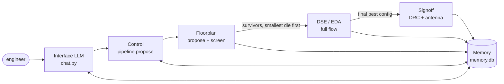

# Adaptive IICPilot

A multi-agent backend-design assistant for OpenROAD-flow-scripts (ORFS,
Nangate45). You ask a question in chat. Python agents run or replay real ORFS
flows and answer from measured data only. Nothing is estimated unless the
answer says so, and an unmeasured config is reported `NOT_RUN`.

## Architecture



```
Interface LLM -> Control -> Floorplan (propose + screen) -> DSE/EDA (full flow on survivors) -> Signoff (DRC + antenna) -> Memory
```

All agents share two things:

* **One config key.** `ConfigKey` (`configkey.py`) is
  `(design, tech, util, density, aspect, margin, pin_strategy, macro_strategy, clock)`,
  with every "stock" value resolved to a concrete one. ORFS cache entries,
  FloorplanAgent results, memory rows and signoff rows are all looked up by
  it. `Measurements` (`measurements.py`) indexes every real measurement
  from both producers under it. A run that one agent has measured is
  replayed by the others, never re-run.
* **One SQLite memory.** `~/.adaptive_iicpilot/memory.db` in WSL, or
  `ADAPTIVE_IICPILOT_MEMORY_DB`.

### Agents

| Stage | Code | Inputs | Outputs | Memory read | Memory written |
|---|---|---|---|---|---|
| **Interface LLM** | `chat.py` (`Session`, `run_turn`, `route_intent`), llama3.1:8b via Ollama | user text; the session's pending offer | one tool call per turn (unambiguous requests are routed in Python); one deterministic `[Verdict]` line per result; the model's short narration, or a ≤300-char fallback | through the tools | none directly (an offer to run lives in the session for one turn) |
| **Control** | `web/compat.Orchestrator`, `pipeline.propose`, `control_agent.py` | design, objective, `MemorySeed` | candidate ConfigKeys. Cold: 4 utils × 3 aspect ratios. Warm: memory's best plus one tighter util rung, unless memory knows that rung is a congestion wall. Then the final report and the time-saved estimate (labelled as one) | `runs`, `decisions`, `corrections`, `heuristics` (`seed_for`) | `decisions`, `heuristics` (`record_session`); `corrections` (HITL edits) |
| **Floorplan** | `floorplan/agent.py`, `floorplan/runner.py`, `pipeline.screened_search` step 2 | candidate ConfigKeys → `FloorplanKnobs` | for each candidate, a screen to global placement (`3_3_place_gp`, own `fp_screen_*` variant): die/core area, congestion, IO HPWL, placement wirelength. Congestion > 1.0 or a failed screen is pruned. Also SVG/PNG renders and macro legality | `floorplan_runs`, `floorplan_best`, `floorplan_corrections` (macro moves) | the same three tables; files in `.floorplan_runs/` |
| **DSE / EDA** | `pipeline.screened_search` step 3, `dse_agent.py`, `eda_agent.py`, `eda_interface.ORFSAdapter` | survivors, smallest screened die first | full ORFS flow until the first one is clean (routable, timing not VIOLATED). `RunResult`: die, congestion, WNS/TNS vs the design's `rules-base.json` limit, power, and **reg-to-reg fmax from the real clock's `finish__timing__fmax__clock__<clock>`** (never the virtual-clock headline) | ORFS cache + FloorplanAgent FULL results (replay by ConfigKey) | `runs` (`record_run`); `.orfs_cache/` |
| **Signoff** | `signoff.py` (`SignoffAgent`) | the final best config only (`optimize(signoff=True)`), or any measured config from chat | KLayout DRC of the run's `6_final.gds` with `signoff/decks/FreePDK45_full.lydrc`: violations per rule and rule category. Router `DRT-0199` final count and `ANT-0002`/`ANT-0001` antenna net/pin counts from `5_2_route.log`. LVS: *not available (ORFS ships no Nangate45 LVS deck)*. One verdict line | `signoff_runs` (replay by ConfigKey) | `signoff_runs`; files in `signoff/runs/<design>/<variant>/` |
| **Memory** | `sqlite_memory.py`, `floorplan/memory.py`, `signoff.SignoffMemory` | everything above | warm seeds, congestion walls, best configs, engineer corrections | — | `runs`, `decisions`, `corrections`, `heuristics`, `floorplan_runs`, `floorplan_best`, `floorplan_corrections`, `signoff_runs` |

### Rules every stage follows

* **fmax is reg-to-reg.** It is taken from the period_min of the SDC's real
  clock (the `create_clock` with a source object). ORFS's headline
  `finish__timing__fmax` is kept as a separate labelled field. For ibex it
  comes from the virtual I/O clock, so it is never used as fmax.
* **The ORFS tree is read-only.** Floorplan runs use their own `fp_*`
  variants. A non-stock clock gets a rewritten SDC outside the tree. Signoff
  writes only under `signoff/runs/`.
* **An unmeasured config is offered, not run.** Chat `floorplan` in
  `mode="config"` shows the measurement of exactly the named config. If none
  exists, it offers a screen or a full run, with measured median times, and
  runs one only after the next reply confirms it. A model-supplied `run=` is
  ignored without that confirmation. If a request leaves utilization out and
  several utilizations are measured, the answer is `AMBIGUOUS`; no other
  config is substituted.

## Running

ORFS, KLayout and the project venv live in WSL:

```bash
cd /mnt/c/Users/<you>/adaptive-iicpilot
~/venvs/iicpilot/bin/python -m adaptive_iicpilot.chat     # terminal chat
~/venvs/iicpilot/bin/python -m pytest -q                  # test suite
```

Chat examples: `optimize ibex`, `show me the best floorplan for ibex`,
`floorplan ibex at 60% util`, `reduce ibex power`, `make ibex as fast as possible`,
`is the best ibex layout DRC clean?`, `run DRC on the best ibex`,
`compare macro placements for tinyRocket`.

See also [adaptive_iicpilot/web/README.md](adaptive_iicpilot/web/README.md)
(web UI) and [vscode-extension/README.md](vscode-extension/README.md).
